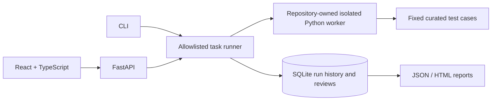

# Architecture

The API and CLI accept task/candidate identifiers, never code. The runner resolves identifiers through a fixed allowlist, invokes a repository-owned worker with JSON input, isolated mode, closed stdin, captured output, and timeout, then persists per-test results. The UI records human review dimensions separately from automated case outcomes.

The worker is a constrained subprocess, not a hardened OS sandbox. The allowlist is a critical trust boundary. SQLite storage and absent authentication make this a local demonstration; do not expose arbitrary code execution publicly.
